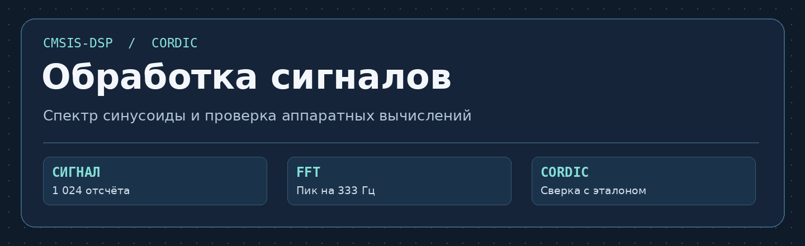

# Встраиваемая обработка сигналов на МК Миландр

Два эксперимента на разных микроконтроллерах. В первом измеряем частоту синусоиды с **CMSIS-DSP**, во втором сравниваем результаты аппаратного **CORDIC** с вычислениями из `math.h`.

| Пример | Микроконтроллер | Что смотреть |
| --- | --- | --- |
| [CMSIS-DSP FFT](examples/cmsis-fft/) | К1986ВЕ1QI | Спектр в `fft_power`, индекс максимума `maxIndex` |
| [Аппаратный CORDIC](examples/cordic/) | К1986ВК01GI | Результат, эталон и отклонение в выводе `printf()` |

## CMSIS-DSP FFT

Пример формирует **1 024 отсчёта** синусоиды 333 Гц при частоте дискретизации 1 024 Гц. `arm_rfft_fast_f32()` преобразует сигнал, затем программа вычисляет модули спектра и ищет максимум. Шаг частоты — 1 Гц, поэтому ожидаемый пик находится в бине **333**.

В [FFT.uvprojx](examples/cmsis-fft/FFT.uvprojx) заданы макросы выбора таблиц для исходного CMSIS-DSP. Они ограничивают набор таблиц для RFFT длиной 1 024 и связанного FFT длиной 512. Проверить, какие таблицы вошли в прошивку, можно по map-файлу сборки.

Для запуска нужен Keil µVision с **Arm Compiler 5.06**, пакетом `Milandr.MDR32FxQI.1.0` и компонентами CMSIS Core и DSP. Исходная конфигурация использует CMSIS Core 5.5.0 и DSP 1.9.0-dev. Возьмите `RTE/Device/` из `FFT.zip` на странице статьи и поместите в каталог примера. [Статья и архив][fft].

## Аппаратный CORDIC

Пример вычисляет синус и косинус в целочисленном режиме, Float32 и Float16. В отдельной части он вычисляет угол и модуль вектора. Для серии входных значений программа сравнивает результат с `math.h` и выводит максимальную ошибку.

Откройте [cordic.uvprojx](examples/cordic/cordic.uvprojx) в Keil µVision с **Arm Compiler 6** и пакетом `Keil.MDR1986VK01.1.3`. Исходный проект рассчитан на Arm Compiler 6.10.1. В **Manage Run-Time Environment** проверьте Startup, CMSIS Core и Compiler I/O. У проекта есть цели **FLASH** и **RAM**. Для вывода из Flash включите ITM Trace в отладчике согласно статье. [Статья и архив][cordic].

Автор обеих статей — **Илья Лампадов**. Исходники приложений и конфигурации проектов собраны здесь, а библиотека CMSIS-DSP и загрузочные файлы подключаются из пакетов. [CMSIS-DSP][fft] · [CORDIC][cordic].

[fft]: https://support.milandr.ru/base/primenenie/programmirovanie-32-razryadnykh-mk/osobennosti-primeneniya-know-how/55372/
[cordic]: https://support.milandr.ru/base/primenenie/programmirovanie-32-razryadnykh-mk/osobennosti-primeneniya-know-how/24230/
